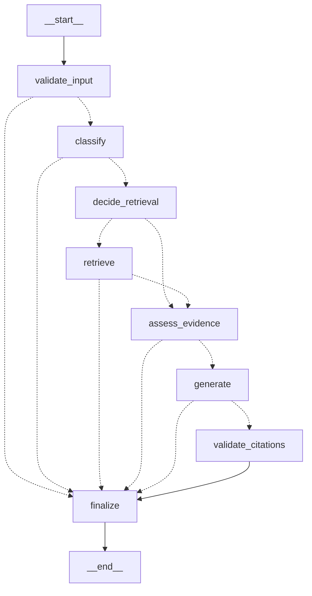

# Architecture: answers, workflow, audit, and optional email

## Request path

```
Browser (vanilla JS)  --cookie + CSRF-->  FastAPI  -->  LangGraph workflow --> PostgreSQL + pgvector
                                              |                 +-----------> DeepSeek (backend only)
                                              +--> audit.events (append-only)
```

The browser never holds a model key. DeepSeek is called only from the backend, with the key read from `DEEPSEEK_API_KEY`.

## Answer workflow (LangGraph)

Generated from the compiled graph (`app.workflow.graph.mermaid`). Dotted edges are conditional.



| Node | Job |
|---|---|
| `validate_input` | Length, patient existence and session ownership. Fails early. |
| `classify` | Deterministic rule-based classifier (lookup, research, comparison, safety). Also runs safety pre-checks: urgent-risk language is escalated, and requests to diagnose, prescribe or pick a treatment are refused. **No model call is made for these.** |
| `decide_retrieval` | Decides from mode and class whether to search. In `auto` mode the model gets a capped search tool instead. |
| `retrieve` | Exact cosine search in pgvector. |
| `assess_evidence` | Records coverage (none / weak / adequate) using similarity floors. These are heuristics, see `docs/retrieval.md`. |
| `generate` | One DeepSeek call (JSON mode, thinking off, bounded retries, at most one repair attempt). |
| `validate_citations` | Removes invalid citation ids, downgrades unsupported claims, stops general-knowledge claims from carrying citations, and removes dosing or directive claims. |
| `finalize` | Builds the response and outcome (`answered`, `refused`, `unsupported`, `urgent`, `no_evidence`, `error`) and writes audit events. |

Modes: `gk` (no retrieval, no citations), `rag` (always retrieve), `both` (retrieve, may add labelled general knowledge), `auto` (the model decides, with at most `LLM_MAX_TOOL_CALLS` searches).

## Audit trail

`audit.events` is append-only (a database trigger rejects UPDATE and DELETE). Each question gets a correlation id `cid-<12 hex>` that links the workflow nodes, retrieval, the model call, citation validation and the answer.

- Stored: ids, counts, settings, statuses, latencies, error codes.
- Never stored: question text, answer text, patient free text, keys, tokens. The sanitizer drops keys that look secret or free-text.
- Endpoints: `GET /api/answers/{cid}/trace`, `GET /api/audit/activity` (your own events), `POST /api/feedback`, `POST /api/audit/ui-events`.

## Optional Gmail summaries

Off unless `EMAIL_TOKEN_ENCRYPTION_KEY` is set and the user opts in from the **Email reports** dialog.

- Separate consent flow with scope `gmail.send` (plus `openid email` to confirm the same Google account). Sign-in itself still asks only for `openid email profile`.
- The refresh token is stored encrypted (Fernet). Turning reports off revokes it at Google.
- The message contains **counts only**. No patient data, questions or answers.
- Limits: one report per `REPORT_MIN_INTERVAL_SECONDS` and `REPORT_MAX_PER_DAY` per user.
- Needs a second redirect URI in Google Cloud and the Gmail API enabled, see `docs/google-oauth-setup.md`.
