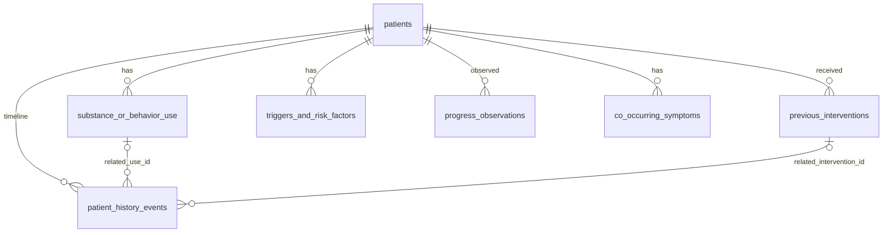

# Data Dictionary: Synthetic Patient Cases (Batch 02)

All data in the `cases` schema is **fictional**. It was written for teaching. It is not drawn from real people, real clinical records, or research results. Outcomes describe what happened to a fictional case. They are not evidence about any intervention.

- **Source of truth:** `backend/db/seed_data/synthetic_cases.json`
- **Schema:** `backend/db/sql/0001_cases_schema.up.sql`
- **Reference date:** every case is described as of `2026-10-01` (`patients.case_as_of`).

## Schemas: keeping data kinds apart

| Schema | Holds | Batch |
| --- | --- | --- |
| `cases` | Synthetic patient cases (this document) | 02 |
| `corpus` | Research documents, chunks, ingestion runs (05); embeddings (06) | 03, 05–06 |
| `chat` | Research chat sessions and messages | 03 |
| `auth` | Users, login sessions | 04 |
| `audit` | Activity and audit events | 09 |

No foreign key crosses schemas (a test enforces this). Later batches refer to a patient only by its stable `patient_id` text, for example in an audit event.

## Relationships

- Every child table has `patient_id → patients.patient_id`, with `ON DELETE CASCADE`.
- History events link to uses and interventions through **composite** foreign keys `(patient_id, related_*_id)`. This means an event can only reference a use or intervention that belongs to the **same** patient.

## Conventions

| Topic | Rule |
| --- | --- |
| Synthetic label | Every table has `is_synthetic boolean NOT NULL DEFAULT true CHECK (is_synthetic)`. `patients.synthetic_notice` carries a readable label. |
| Categorical values | `text` + `CHECK` lists, not `ENUM` types, so later migrations can extend them cheaply. |
| Partial dates | Stored as a `(date, precision)` pair. `precision ∈ {day, month, year, unknown}`. Month precision is stored as the 1st of the month and year precision as 1 January. `unknown` ⇔ the date is `NULL`. This is enforced by `cases.valid_partial_date()`. Display with `cases.format_partial_date()`. |
| Missing values | `NULL` in a free-text or numeric column means **not recorded in the case file**. It never means "zero" or "none". Categorical columns use the explicit value `unknown` instead of `NULL`. |
| Blank text | Text columns use the `cases.nonempty_text` domain, so blank strings are rejected. Use `NULL` for missing values. |
| Timestamps | `created_at` and `updated_at` (`timestamptz`) on every table. `updated_at` is maintained by a trigger. |
| Order | `patient_history_events.sequence_no` is the authoritative chronological order. It still works when dates are partial or unknown. |

### Shared value lists

- **`info_source`** (where a fact came from): `self_report`, `clinician_observation`, `family_report`, `screening_tool`, `lab_test`, `records`, `unknown`
- **`use_category`**: `alcohol`, `cannabis`, `opioids`, `stimulants`, `behavioral`, `tobacco`, `sedatives`, `other`
- **Stage of change**: `precontemplation`, `contemplation`, `preparation`, `action`, `maintenance`, `unknown`

---

## `cases.patients`

One row per synthetic case.

| Column | Type | Null | Purpose |
| --- | --- | --- | --- |
| `patient_id` | text PK | no | Stable synthetic ID `P-001`…`P-010` (format `^P-[0-9]{3}$`). Used by the API, frontend, and audit logs. |
| `is_synthetic` | boolean | no | Always `true` (CHECK). Labels the row as fictional. |
| `synthetic_notice` | text | no | Readable label shown with the case. |
| `case_as_of` | date | no | Reference date the case describes. No dated fact may be later than this. |
| `age_years` | smallint | no | Age on `case_as_of`. Must be 18–100 (adults only). |
| `gender` | text | no | `female`, `male`, `non_binary`, `not_recorded`. |
| `primary_category` | text | no | `alcohol`, `cannabis`, `opioids`, `stimulants`, `behavioral`. It **describes** the case and does not decide treatment suitability. Must equal the category of the primary use. |
| `primary_concern_label` | text | no | Short label for lists, e.g. "Opioids (heroin)". |
| `presenting_concern` | text | no | One-sentence reason the case came to attention. |
| `brief_history` | text | no | Two-sentence summary for the patient explorer. |
| `treatment_summary` | text | no | One-line summary of treatment so far. |
| `occupation` | text | yes | Fictional occupation. `NULL` = not recorded (e.g. P-005). |
| `living_situation` | text | no | Household and housing. |
| `social_context` | text | no | Relationships, peer environment, supports. |
| `motivation_stage` | text | no | Current stage of change. Must equal the latest `motivation_stage` observation. |
| `motivation_notes` | text | yes | Nuance the stage alone does not capture (goals, ambivalence). |
| `progress_summary` | text | no | Narrative of current progress, shown with the progress measures. |
| `created_at`, `updated_at` | timestamptz | no | Row bookkeeping. |

## `cases.substance_or_behavior_use`

The substances or behaviours involved in a case. **Exactly one row per patient is primary** (enforced by a partial unique index).

| Column | Type | Null | Purpose |
| --- | --- | --- | --- |
| `use_id` | integer PK (identity) | no | Surrogate key. |
| `patient_id` | text FK | no | Owning case. |
| `is_synthetic` | boolean | no | Always `true`. |
| `target` | text | no | What is used or done, e.g. `heroin`, `online sports betting`. Unique per patient. |
| `category` | use_category | no | Grouping for comparison. |
| `is_primary` | boolean | no | The main concern of the case. |
| `first_use_age` | smallint | yes | Age at first use or engagement. `NULL` = not recorded. |
| `regular_use_age` | smallint | yes | Age when use became regular or problematic. `NULL` = not recorded. Must be ≥ `first_use_age`. |
| `pattern_description` | text | no | How the use typically happens. |
| `frequency_at_intake` | text | yes | Frequency when the current episode of care began. `NULL` = not recorded. |
| `quantity_at_intake` | text | yes | Amount or extent at intake. `NULL` = not recorded. |
| `route` | text | no | `oral`, `smoked_or_vaped`, `intranasal`, `injected`, `sublingual`, `mixed`, `not_applicable`, `unknown`. Behavioural targets must be `not_applicable`, and substances must not be (CHECK). |
| `current_status` | text | no | Status on `case_as_of`: `active`, `reduced`, `abstinent`, `stable_on_treatment`, `unknown`. |
| `notes` | text | yes | Clarifies missing values, e.g. "Quantity not recorded." |

## `cases.previous_interventions`

Interventions in the case history, including ongoing ones.

| Column | Type | Null | Purpose |
| --- | --- | --- | --- |
| `intervention_id` | integer PK (identity) | no | Surrogate key. |
| `patient_id` | text FK | no | Owning case. |
| `is_synthetic` | boolean | no | Always `true`. |
| `name` | text | no | Display name, e.g. "Buprenorphine maintenance". |
| `intervention_type` | text | no | `brief_intervention`, `psychosocial`, `pharmacological`, `withdrawal_management`, `residential_or_inpatient`, `harm_reduction`, `family_based`, `self_exclusion_or_blocking`, `monitoring`, `self_directed`, `mutual_help`, `other`. |
| `setting` | text | no | `primary_care`, `emergency_department`, `outpatient`, `inpatient`, `community`, `university`, `home`, `online_or_phone`, `self`, `other`, `unknown`. |
| `start_date`, `start_precision` | date, text | date yes | Partial start date. |
| `end_date`, `end_precision` | date, text | yes | **Ongoing:** both `NULL` (not applicable). **Ended:** a precision is required. `unknown` means it ended on an unrecorded date. End ≥ start. |
| `status` | text | no | `completed`, `ongoing`, `discontinued`, `unknown`. |
| `sessions_offered` | smallint | yes | `NULL` = not recorded. |
| `sessions_attended` | smallint | yes | `NULL` = not recorded. Must be ≤ `sessions_offered`. |
| `outcome_summary` | text | no | What happened **in this fictional case**. It is not a research finding. |

## `cases.patient_history_events`

The chronological timeline of a case.

| Column | Type | Null | Purpose |
| --- | --- | --- | --- |
| `event_id` | integer PK (identity) | no | Surrogate key. |
| `patient_id` | text FK | no | Owning case. |
| `is_synthetic` | boolean | no | Always `true`. |
| `sequence_no` | smallint | no | Order within the case (1, 2, 3…). Unique per patient. |
| `event_date`, `date_precision` | date, text | date yes | Partial date. |
| `event_type` | text | no | `use_onset`, `use_escalation`, `life_event`, `health_event`, `occupational_or_academic`, `referral`, `treatment_start`, `treatment_end`, `lapse`, `relapse`, `milestone`, `other`. |
| `description` | text | no | One-sentence event description. |
| `related_use_id` | integer | yes | Same-patient use this event concerns. **Required** for `use_onset` and `use_escalation`. |
| `related_intervention_id` | integer | yes | Same-patient intervention. **Required** for `treatment_start` and `treatment_end`. |
| `source` | info_source | no | Where the fact came from. |

## `cases.triggers_and_risk_factors`

Triggers, risk factors, and **protective** factors. Protective factors are included so that comparisons aren't only about risk.

| Column | Type | Null | Purpose |
| --- | --- | --- | --- |
| `factor_id` | integer PK (identity) | no | Surrogate key. |
| `patient_id` | text FK | no | Owning case. |
| `is_synthetic` | boolean | no | Always `true`. |
| `factor_type` | text | no | `trigger` (situation linked to use), `risk_factor` (background vulnerability), `protective_factor` (support or strength). |
| `domain` | text | no | `emotional`, `social`, `environmental`, `physical`, `occupational_or_academic`, `financial`, `family`, `other`. |
| `description` | text | no | Short description. Unique per patient and type. |
| `salience` | text | no | How prominent the factor is in the case: `low`, `moderate`, `high`, `unknown`. |
| `source` | info_source | no | Where the fact came from. |

## `cases.progress_observations`

Observed behaviours, progress measures, and stage-of-change readings over time.

| Column | Type | Null | Purpose |
| --- | --- | --- | --- |
| `observation_id` | integer PK (identity) | no | Surrogate key. |
| `patient_id` | text FK | no | Owning case. |
| `is_synthetic` | boolean | no | Always `true`. |
| `observed_on`, `observed_precision` | date, text | date yes | Partial date of the observation. |
| `observation_type` | text | no | `behavior` (observed behaviour), `measure` (indicator with optional baseline), `motivation_stage` (stage reading), `note`. |
| `label` | text | no | What was observed, e.g. "Bet-free weeks". |
| `value_text` | text | no | The value as recorded ("~2", "7 of 8", "Improving"). For `motivation_stage` it must be a stage value. |
| `value_numeric` | numeric | yes | Machine-usable value when one exists. `NULL` for ranges and qualitative values. |
| `unit` | text | yes | Unit of the value, e.g. `days/week`. |
| `baseline_text` | text | yes | Value at the start of the current episode, for comparison. `NULL` = no baseline recorded. |
| `source` | info_source | no | Where the fact came from. |

## `cases.co_occurring_symptoms`

Co-occurring symptoms described in the case. These are **case descriptions, not diagnoses**.

| Column | Type | Null | Purpose |
| --- | --- | --- | --- |
| `symptom_id` | integer PK (identity) | no | Surrogate key. |
| `patient_id` | text FK | no | Owning case. |
| `is_synthetic` | boolean | no | Always `true`. |
| `description` | text | no | Symptom as described. Unique per patient. |
| `domain` | text | no | `mood`, `anxiety`, `sleep`, `trauma_related`, `psychotic`, `cognitive`, `physical_health`, `other`. |
| `status` | text | no | `current`, `improving`, `past`, `unknown` (explicitly not reassessed). |
| `noted_since`, `noted_precision` | date, text | date yes | When it was first documented. `unknown` if not recorded. |
| `source` | info_source | no | Where the fact came from. |
| `notes` | text | yes | Context, often explaining a missing value. |

## Batch 03 tables (outside `cases`)

These hold catalogue and user data, not patient facts. `chat.sessions.patient_id` refers to a case by its stable id **without** a foreign key. That way the synthetic cases can be re-seeded (`TRUNCATE`) without touching anyone's sessions. The API checks that the patient exists before it creates a session.

### `corpus.documents` (was `corpus.papers` until migration 0004)

Bibliographic fields come from `data/corpus_manifest.json`. File and extraction fields are written by ingestion.

| Column | Type | Null | Purpose |
| --- | --- | --- | --- |
| `document_id` | text PK | no | Stable id such as `WHO-GL-2023`; prefix of its chunk ids. |
| `title`, `short_title` | text | no | As printed in the document. |
| `authors` | text[] | no | Personal authors as printed (empty for corporate works). |
| `corporate_author`, `publisher` | text | yes / no | Issuing organization(s). |
| `year`, `venue`, `edition` | smallint, text, text | yes | As printed. `NULL` when not printed. |
| `doi`, `isbn` | text | yes | As printed, with format checks. |
| `document_type` | text | no | `guideline`, `intervention_guide`, `research_guide`, `systematic_review`, `other`. |
| `license` | text | yes | Licence or rights statement as printed. |
| `metadata_verified`, `verification_note` | boolean, text | no / yes | Whether the metadata was checked against the PDF, and where. |
| `source_filename` | text | yes | File in the source directory. |
| `file_sha256`, `file_size_bytes` | text, bigint | yes | Checksum and size of the ingested file. The checksum is unique. |
| `page_count`, `text_char_count` | integer | yes | From extraction. |
| `storage_path` | text | yes | Name of the stored original under `DOCUMENT_STORAGE_DIR`. |
| `extracted_metadata` | jsonb | no | What the PDF itself says: embedded metadata, DOI, ISBN, years, title guess, topic mention counts, quality metrics, heading source, and comparison warnings. |
| `outline` | jsonb | no | Detected headings `[{level, title, page}]`. |
| `ingestion_status` | text | no | `not_ingested`, `ingesting`, `ingested`, `failed`, `needs_ocr`, `missing_file`. |
| `ingestion_error` | text | yes | Last error, e.g. `needs_ocr: 12 of 12 pages have no text layer …`. |
| `ingest_fingerprint`, `ingested_at` | text, timestamptz | yes | Idempotency key and time of the last successful ingestion. |
| `chunk_count` | integer | no | Number of chunks. |
| `notes`, `created_at`, `updated_at` | — | — | Bookkeeping. |

### `corpus.chunks`

| Column | Type | Null | Purpose |
| --- | --- | --- | --- |
| `chunk_id` | text PK | no | `<document_id>-c<NNNN>`, e.g. `NIDA-PDAT-c0007`. |
| `document_id` | text FK | no | → `corpus.documents`, `ON DELETE CASCADE`. |
| `ordinal` | integer | no | Position in the document (unique per document). |
| `section_path` | text[] | no | Headings from the document root to the chunk's section. |
| `page_start`, `page_end` | integer | no | 1-based **PDF** page numbers. |
| `page_label_start`, `page_label_end` | text | yes | Page numbers as **printed** (e.g. `xix`, `29`), when the PDF defines labels. |
| `text` | text | no | Chunk text (whole paragraphs where possible, plus overlap). |
| `token_count`, `char_count` | integer | no | Estimated tokens (words + punctuation), and characters. |
| `content_hash` | text | no | sha256 of `text`. |
| `created_at` | timestamptz | no | Bookkeeping. |

### `corpus.ingestion_runs`

| Column | Type | Null | Purpose |
| --- | --- | --- | --- |
| `run_id` | uuid PK | no | Run identifier. |
| `triggered_by` | text | no | `cli`, `test`, or `user:<user_id>`. |
| `started_at`, `finished_at` | timestamptz | — | Timing. |
| `status` | text | no | `running`, `succeeded`, `partial` (some documents failed), `failed`. |
| `source_dir`, `manifest_path` | text | no | Inputs used. |
| `pipeline_version`, `chunking_config` | text, jsonb | no | Settings used (part of each document's fingerprint). |
| `results` | jsonb | no | One entry per manifest document and per unlisted file: `action`, `severity`, `message`, `chunk_count`, `warnings`. |

### `chat.sessions`

| Column | Type | Null | Purpose |
| --- | --- | --- | --- |
| `session_id` | uuid PK | no | Generated by the database. |
| `owner_user_id` | uuid FK | no | Owning user → `auth.users`, `ON DELETE CASCADE` (since migration 0003). |
| `patient_id` | text | no | Synthetic case discussed (`^P-[0-9]{3}$`). Validated by the API, not by an FK. |
| `title` | text | yes | Optional label, 1–120 characters. |
| `mode` | text | no | Default source mode: `gk`, `rag`, `both`. |
| `created_at`, `updated_at` | timestamptz | no | Bookkeeping. |

### `chat.messages`

| Column | Type | Null | Purpose |
| --- | --- | --- | --- |
| `message_id` | uuid PK | no | Generated by the database. |
| `message_seq` | bigint identity | no | Stable ordering for pagination. |
| `session_id` | uuid FK | no | → `chat.sessions`, `ON DELETE CASCADE`. |
| `role` | text | no | `user` or `assistant`. |
| `content` | text | no | Message text. |
| `mode` | text | no | Source mode used for this message. |
| `correlation_id` | text | yes | Links the message to its audit events (Batch 09). |
| `created_at` | timestamptz | no | Bookkeeping. |

## Batch 04 tables (`auth`)

### `auth.users`

| Column | Type | Null | Purpose |
| --- | --- | --- | --- |
| `user_id` | uuid PK | no | Internal id, referenced by `chat.sessions.owner_user_id`. |
| `google_sub` | text UNIQUE | no | Google's stable subject identifier (`sub`). **The identity.** |
| `email` | text | no | Latest verified Google email. Updated on each sign-in; not unique and not the key. |
| `email_verified` | boolean | no | Always true for stored users (unverified emails cannot sign in). |
| `display_name` | text | yes | Google profile name, if shared. |
| `role` | text | no | `student` (default) or `instructor` (from `INSTRUCTOR_GOOGLE_SUBS`, re-evaluated at sign-in). |
| `is_active` | boolean | no | false = sign-in refused and existing sessions stop working. |
| `created_at`, `updated_at`, `last_login_at` | timestamptz | — | Bookkeeping. |

### `auth.login_sessions`

| Column | Type | Null | Purpose |
| --- | --- | --- | --- |
| `login_session_id` | uuid PK | no | Internal id. |
| `user_id` | uuid FK | no | → `auth.users`, `ON DELETE CASCADE`. |
| `token_hash` | bytea UNIQUE | no | HMAC-SHA256(`SESSION_SECRET`, cookie token). The raw token is never stored. |
| `csrf_token` | text | no | Synchronizer token required in `X-CSRF-Token` on POSTs. |
| `created_at`, `expires_at` | timestamptz | no | Absolute lifetime (`SESSION_TTL_HOURS`). |
| `last_seen_at` | timestamptz | no | Updated at most every 5 minutes. |
| `revoked_at` | timestamptz | yes | Set on sign-out. |

## Batch 06 tables (`corpus`, semantic retrieval; migration 0005, needs pgvector)

### `corpus.embedding_models`

| Column | Type | Null | Purpose |
| --- | --- | --- | --- |
| `model_id` | text PK | no | `<name>@<version>#<dimension>`: the exact model identity. |
| `name`, `version` | text | no | Model name; version = Hugging Face revision + library version (or `1` for the test embedder). |
| `dimension` | integer | no | Vector length; must match the `vector(384)` column. |
| `metric` | text | no | Always `cosine`. |
| `normalized` | boolean | no | Vectors are L2-normalised. |
| `settings` | jsonb | no | Window size and overlap used to build the index. |
| `is_active` | boolean | no | At most one model is active (partial unique index); a trigger rejects embeddings from any other model. |

### `corpus.chunk_embeddings`

| Column | Type | Null | Purpose |
| --- | --- | --- | --- |
| `chunk_id`, `window_no` | text, integer | no | Primary key. A chunk has several overlapping windows. |
| `chunk_id` | FK | no | → `corpus.chunks`, `ON DELETE CASCADE` (vectors vanish with their chunk). |
| `model_id` | FK | no | → `corpus.embedding_models`. |
| `embedding` | vector(384) | no | The window's embedding. |
| `char_start`, `char_end` | integer | no | The window's offsets in `corpus.chunks.text` (the best-matching passage is shown from these). |
| `content_hash` | text | no | The chunk's `content_hash` when embedded (stale check). |

No ANN index: exact search is used for this corpus size (see `docs/retrieval.md`).

### `corpus.embedding_failures`

| Column | Type | Null | Purpose |
| --- | --- | --- | --- |
| `chunk_id`, `model_id` | FKs | no | Chunk that could not be embedded after all retries (primary key together). |
| `attempts`, `last_error`, `failed_at` | — | no | Retry count, error text, time. Cleared when a later run succeeds. |

## Helper functions

| Function | Purpose |
| --- | --- |
| `cases.valid_partial_date(date, text)` | True when a (date, precision) pair is well formed. Used in CHECK constraints. |
| `cases.format_partial_date(date, text)` | Returns `'2024'`, `'2024-03'`, `'2024-03-15'`, or `'date not recorded'`. |
| `cases.set_updated_at()` | Trigger function that maintains `updated_at`. |

## Consistency rules

Rules are enforced in two layers.

**Table constraints** reject bad writes:
- ID format, adult age, and the synthetic flag
- well-formed partial dates, end dates after start dates, and attended sessions ≤ offered
- exactly one primary use per patient, and routes that match the category
- treatment and use events must link to an intervention or use of the same patient
- ongoing interventions have no end date
- text is never blank

**Dataset checks** live in `backend/db/checks/consistency_checks.sql`. Each check returns the rows that break it, and the tests require every check to return nothing:

| Check | Rule |
| --- | --- |
| `expected_patient_ids` | Exactly P-001…P-010. |
| `synthetic_labels` | Every row is synthetic; every patient has the notice. |
| `primary_use_matches_category` | Primary use category = `patients.primary_category`. |
| `minimum_case_content` | Each case has ≥5 events, ≥3 triggers, ≥1 protective factor, ≥2 interventions, behaviours, measures, and a stage reading. |
| `no_dates_after_case_as_of` | Nothing happens after the reference date. |
| `event_sequence_is_chronological` | Dates never go backwards in sequence order, compared at the coarser precision. |
| `every_intervention_starts_on_the_timeline` | Each intervention has exactly one matching `treatment_start` event (same date and precision). |
| `treatment_end_events_match_interventions` | `treatment_end` events match an ended intervention's end date. |
| `relapses_and_lapses_name_a_use` | A relapse or lapse says what was returned to. |
| `relapse_follows_a_treatment_or_milestone` | A relapse comes after some change attempt. |
| `current_stage_matches_latest_observation` | Current stage = latest stage reading, with no same-day duplicates. |
| `onset_ages_match_timeline` | Onset ages agree (±1 year) with dated onset and escalation events, and don't exceed the current age. |
| `use_status_has_treatment_context` | Reduced, abstinent, or stable status has a treatment history to explain it. |
| `no_contact_details_or_links` | No emails, phone-like numbers, or URLs in any text. |

## Dataset design notes

- **Variation within a category.** The three alcohol cases are deliberately different:
  - P-001: daily drinking in midlife, relapse after withdrawal management, CBT group.
  - P-002: young binge pattern, a goal of reduced drinking, monitoring.
  - P-010: late-onset drinking after bereavement, falls, a supervised reduction.

  The two opioid cases differ in onset route, housing, and stage, as do the two stimulant cases and the two behavioural cases. `db/queries/compare_cases.sql` shows these differences side by side.
- **Explicit unknowns.** Unknowns are recorded rather than made up. Examples:
  - routes (P-004, P-007), quantities (P-003, P-005, P-006, P-007), and occupation (P-005)
  - symptom onset dates (P-003, P-005, P-007), and session attendance (P-003)
  - a cardiology outcome (P-006 chest pain, status `unknown`) and a tremor that hasn't been reassessed (P-001)
- **No research claims.** Outcome text describes the fictional person only. A test rejects wording such as "studies show" in case text.
- **Consistency with the frontend.** These cases extend the Batch 01 mock (`frontend/js/data/mockData.js`) with the same facts and timelines. See `docs/frontend-integration-plan.md`.
